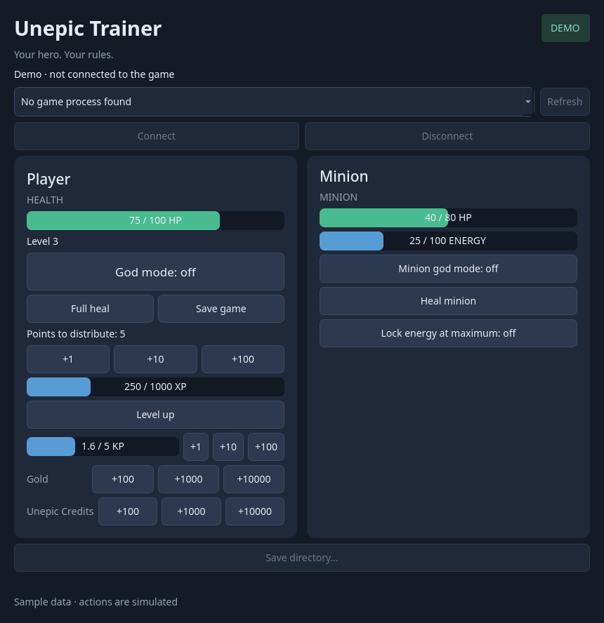

# Unepic Trainer

A standalone desktop trainer for the **native Linux, single-player version of Unepic**.
Heal your character and companions, enable independent god modes, keep minion energy
full, add progression points and currencies, and request a save from the game.



Written in Python with a PySide6/Qt interface and a GDB backend. Python and Qt are
included in the AppImage; **GDB must be installed separately**. REA, Ghidra, PINCE
and scanmem are development tools and are not required to use the trainer.

## Features

| Section | Control | Behavior |
|---|---|---|
| Player | HP and XP bars | Shows current/max health, level, XP and available points. |
| Player | Full heal | Restores HP to the character's current maximum. |
| Player | God mode | Protects at the known direct and periodic damage stores; enemies remain vulnerable. |
| Player | Points to distribute | Adds **+1, +10 or +100** skill points. |
| Player | Level up | Reaches the current XP threshold and invokes normal level-up on the next game update, without requiring a kill. Campaign maximum: **25**. |
| Player | Gold | Adds **+100, +1,000 or +10,000** through the native inventory award. |
| Player | Unepic Credits | Adds **+100, +1,000 or +10,000**, using the saved credits counter and normal inventory rebuild. |
| Player | Kill Points | Adds **+1, +10 or +100 KP**, capped at **5 KP**. Requires the existing in-game unlock; +10/+100 fill the bar. |
| Player | Save game | Requests the normal manual save in the current slot, including Hard/Hard++, without changing difficulty. |
| Minion | HP and ENERGY bars | Shows living companions owned by the current player in the current room. |
| Minion | Heal minion | Restores eligible companions to full HP. |
| Minion | God mode | Protects companions independently of the player. |
| Minion | Lock energy at maximum | Fills ENERGY and maintains its current maximum through known spending/regeneration stores. |

With several eligible companions, bars show totals and minion controls apply to all.
Recalled, dead and foreign pets are excluded. The three protection toggles are independent.

## Download and run

Get `Unepic-Trainer-<version>-x86_64.AppImage` and `SHA256SUMS` from
[Releases](https://github.com/0xAF/unepic-trainer/releases).

Requires **x86_64 Linux, glibc 2.36 or newer**, a graphical desktop and system GDB.
Builds use Debian 12. Your distribution still needs the usual Qt display/graphics
libraries. Windows, Proton and multiplayer are not supported.

Install GDB with your package manager:

```bash
# Arch Linux
sudo pacman -S gdb

# Debian / Ubuntu
sudo apt install gdb
```

For version 0.1.0:

```bash
sha256sum --check SHA256SUMS
chmod +x Unepic-Trainer-0.1.0-x86_64.AppImage
./Unepic-Trainer-0.1.0-x86_64.AppImage
```

If FUSE mounting is unavailable:

```bash
./Unepic-Trainer-0.1.0-x86_64.AppImage --appimage-extract-and-run
```

Add `--demo` to preview the interface without the game.

1. Launch the **native Linux build** of Unepic through Steam and load your character.
2. Open the trainer, refresh the process list, select Unepic and connect.
3. Use Player and Minion controls. Resume a paused game to execute queued progression,
   currency, KP or save requests.
4. Disconnect or close normally when finished, allowing the trainer to restore its hooks.

The trainer never edits the installed game executable.

## Supported game build

Only the analyzed Linux x86_64 executable **`unepic64s`** is accepted:

```text
SHA256: 62c04002b98eee3f33d0f8c27030b1f5ea23d3ede56d62af9da6b1436a583962
```

Hashes, process identity, memory values and original instruction bytes are checked
before changes. A different Steam build needs its own analysis/profile.
Integrity checks remain active; progression and gold use native game routines to
maintain protected values.

## Backups and saving

Before the first change, discovered saves are copied and verified.
AppImage backups live in `~/.local/share/unepic-trainer/backups/`, or
`$XDG_DATA_HOME/unepic-trainer/backups/` when an absolute XDG path is configured.
The source launcher uses the project directory.

If discovery fails, use **Save directory…** or specify the saves:

```bash
./Unepic-Trainer-0.1.0-x86_64.AppImage --save-dir /path/to/saves
```

Use `--project-dir /path/to/trainer-data` to override the backup root. A manifest
records file sizes and SHA256 hashes. Backups remain local. Restore them manually;
actual-game restoration has not been validated.

**Save game** reports that the game consumed the request. Check its confirmation
or error; this does not independently prove a completed Steam storage write.
The current slot (0–8) is used.

## Process access and troubleshooting

Run the trainer and game as your regular user with permission for GDB to attach.
Yama/ptrace policy can block attachment to a Steam-launched process. The trainer
does not elevate privileges or change system policy. Failed attachment installs no hook.

- **Unsupported build:** compare the executable hash; Proton/Windows builds differ.
- **Cannot attach / Operation not permitted:** check host debugger policy and whether another debugger owns the process.
- **Manual readings only:** live memory access is blocked; use **Refresh** for a stopped reading.
- **Request stays pending:** resume the game to let its character update run.
- **KP buttons unavailable:** unlock KP in the game first, or check whether the bar is full.
- **No minion:** summon a living owned companion in your current room.
- **Qt xcb error:** install your distribution's Qt/X11 runtime libraries, including `libxcb-cursor` (`libxcb-cursor0` on Debian/Ubuntu).
- **Restoration failed:** keep the trainer open for recovery; another close request retries. The game can remain paused during recovery.

Polling reads memory without stopping the game. Changes and restoration briefly
stop its threads. Window close, Ctrl-C and SIGTERM share cleanup; forced process
termination bypasses it.

## Verification and limitations

The supported game has user-reported successful connection, HP tracking, healing,
ordinary player god mode and damage restoration after disabling it. The user also
reported the polling/shutdown problems resolved after correction.

Automated tests cover owned native fixtures, emulated CPU context, hash/PID checks,
protected data, backups, dispatch, hook restoration and Qt controls. GDB integration
tests skip explicitly when the environment denies ptrace.

Detailed actual-game checks of fire/poison, minion transitions, newer progression,
currency/KP features and Hard/Hard++ save/reload remain pending. Scripted deaths or
other direct HP changes are not guaranteed to be covered. Live-game AppImage and
cross-distribution testing remain limited. See [runtime notes](runtime-notes/).

## Run from source

Requires Python 3.11+, GDB and a C compiler for native test fixtures.

```bash
git clone https://github.com/0xAF/unepic-trainer.git
cd unepic-trainer
python -m venv .venv
.venv/bin/python -m pip install -e '.[test]'
./run.sh --demo
./run.sh
QT_QPA_PLATFORM=offscreen .venv/bin/python -m pytest -q -rs
```

## Build and release

Docker and GitHub Actions use the same pinned build inputs.
[Packaging instructions](docs/packaging.md) cover local builds and smoke checks.
A matching version tag such as `v0.1.0` runs tests, builds the AppImage, checks
startup/debugger/cleanup and publishes the AppImage and `SHA256SUMS` to Releases.

Developer references: [design](DESIGN.md), [plan](PLAN.md),
[analysis summary](rea-analysis/README.md). Raw REA exports, game binaries, saves,
backups and local build caches are excluded from Git.

## License

Original trainer code, documentation and icon: [MIT](LICENSE).
Dependencies retain their own licenses; see [third-party notices](THIRD_PARTY_NOTICES.md).
This unofficial project is not affiliated with Unepic or Steam.
